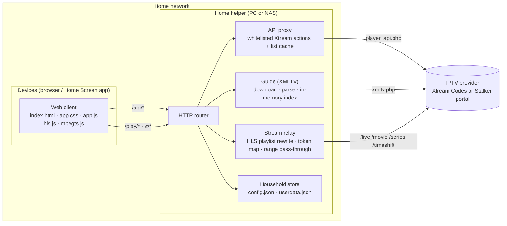
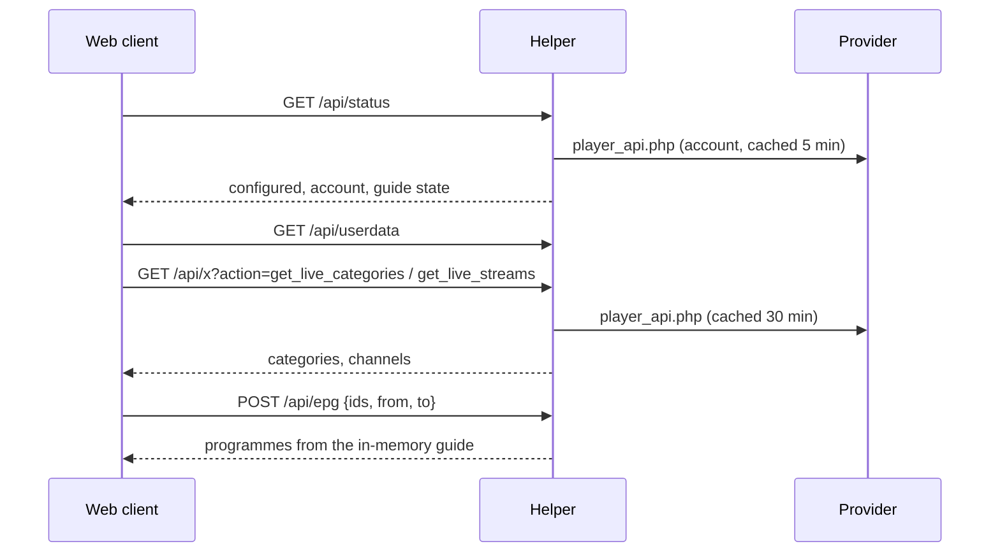
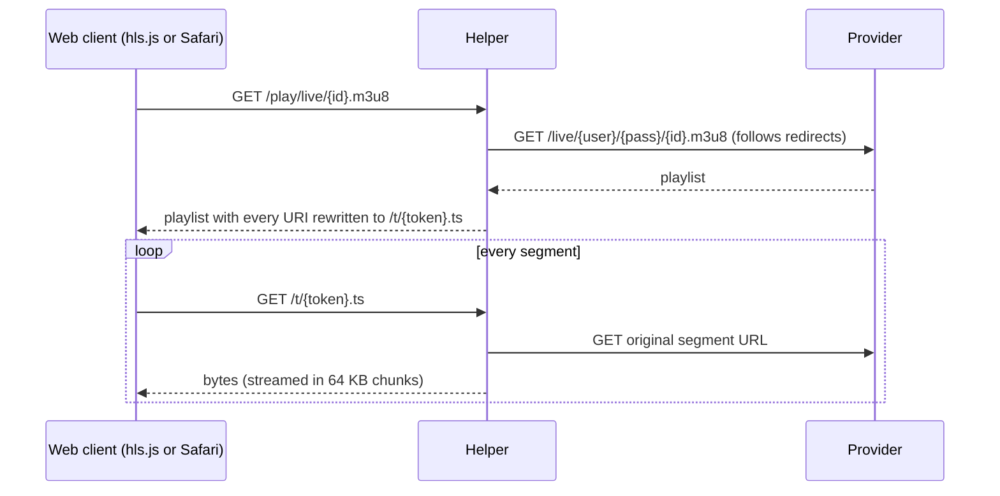

# HomeTV web app: technical plan

Status: Accepted · Owner: architect agent · Last updated: 2026-11-01

HomeTV's web app is a home-network streaming app for one household. You add it to the Home Screen on iPhone and iPad first, then use it on Android, Fire tablets, the Fire TV Silk browser and computers.
It has two parts: a **home helper** (Python, runs on the Windows PC or the Synology NAS) and a **web client** (plain HTML/CSS/JS served by the helper).
Phase 1 is built and passes automated tests against a mock provider. This plan covers hardening it, restructuring it for agent-driven development, and the web-only features that follow.

Related: [Agentic harness](02-agentic-harness.md) · [Features](features/FEATURES.md) · [API](api/API.md) · [Data model](database/DATA-MODEL.md) · [Decisions](decisions/README.md) · [Roadmap](ROADMAP.md) · [Test plan](testing/TEST-PLAN.md) · [Design spec](design/README.md)

---

## 1. Scope

**In scope (web app)**

- Live TV, TV guide, catch-up, movies, series, search, favorites, continue watching, hidden groups, settings.
- iPhone and iPad first (portrait and landscape, Add to Home Screen), then desktop and TV-size browsers with remote/keyboard.
- The home helper: provider access, stream relay, guide cache, and shared household data.

**Out of scope here:** native Apple (Phase 2) and Android/Fire TV (Phase 3) apps; they get their own plans and reuse the API and data model below.

## 2. Constraints that drive the design

| Constraint | Consequence |
| --- | --- |
| Providers serve `http://` streams and APIs with no CORS headers | Browsers can't call the provider directly; the helper must relay ([ADR-0001](decisions/0001-home-helper-relays-browser-traffic.md)) |
| Provider login is a secret and often limited to 1–2 devices at once | Credentials live only on the helper; segment URLs are opaque tokens ([ADR-0005](decisions/0005-opaque-stream-tokens.md)) |
| Runs on a home Windows PC or a Synology NAS | Python standard library only, no database server, Docker for the NAS ([ADR-0002](decisions/0002-python-standard-library-helper.md)) |
| Old TVs, Fire Stick Silk, iOS Home Screen mode | No build step, no framework, ES2020 only ([ADR-0003](decisions/0003-plain-web-no-build-step.md)) |
| Over plain `http://` on the LAN, browsers don't allow service workers | No offline mode or full PWA install unless local HTTPS is added later (F-023) |
| One household, a few devices | JSON files are enough for shared data until profiles/DVR ([ADR-0004](decisions/0004-json-files-for-household-data.md)) |
| The household's provider is a **Stalker/MAG portal** (portal URL + MAC, no username/password), usually one session per MAC | Provider adapters (Xtream, Stalker) behind the same API ([ADR-0010](decisions/0010-provider-adapters-xtream-and-stalker.md), F-036); warn that iSTB and HomeTV may log each other out |

## 3. Architecture

### 3.1 Key flows

**App start**

**Live playback (HLS)**

If HLS isn't allowed or fails, the client retries the same channel as `/play/live/{id}.ts` through mpegts.js. Then it shows the provider's error message with an "Open in VLC" link.

**Catch-up:** `/play/timeshift/{id}.{ext}?start={unix}&dur={min}`. The helper converts `start` to the provider's clock using `tz_offset`, which comes from `server_info.time_now` vs `timestamp_now`.

**Sync:** favorites, hidden groups and progress are written through `/api/favorite`, `/api/hidden` and `/api/progress` to `userdata.json`. Every device reads them at start-up.

## 4. Tech stack

| Layer | Choice | Version | Notes |
| --- | --- | --- | --- |
| Helper runtime | Python standard library | 3.10+ (tested 3.13) | `http.server.ThreadingHTTPServer`, `urllib`, `xml.etree.iterparse`, `gzip` |
| Helper packaging | Windows `.bat` launcher + Startup shortcut; Docker (`python:3.12-slim`) for Synology | n/a | No pip packages at runtime |
| Web client | HTML5, CSS (custom properties, grid, container-safe areas), vanilla JavaScript (ES2020) | n/a | No bundler, no framework |
| Playback | Safari native HLS on Apple; hls.js elsewhere; mpegts.js for raw MPEG-TS | hls.js 1.7.4, mpegts.js 1.8.2 (bundled in `web/lib`) | Apache-2.0 |
| Fonts | Bricolage Grotesque (titles), Atkinson Hyperlegible (UI) | bundled woff2 | SIL OFL |
| Install | Web app manifest + `apple-touch-icon` + `apple-mobile-web-app-capable` | n/a | Home Screen standalone mode on iOS |
| Tests | Mock Xtream provider (Python) + Playwright (Node) end-to-end; `unittest` for helper modules (planned) | Playwright ^1.48 | ffmpeg makes the test media |
| Tooling | Git, Claude Code agents (see harness) | n/a | Windows 11 dev machine |

## 5. Backend (home helper) design

Today the helper is one file (`development/helper/server.py`, about 680 lines). Milestone M3 splits it into a stdlib-only package without changing behaviour or the API:

| Module (planned) | Responsibility | Today in `server.py` |
| --- | --- | --- |
| `hometv/config.py` | Load/save `config.json`, normalise server URL, user agent | `normalize_server`, `config` |
| `hometv/providers/` | Provider interface + `xtream.py` (today's calls, account status, `tz_offset`) + `stalker.py` (handshake, MAG headers, genres/channels/VOD/series translation, `create_link`), returning Xtream-shaped data (ADR-0010, F-036) | `api_url`, `fetch_json`, `provider_status` |
| `hometv/cache.py` | Time-boxed list cache for cacheable actions | `_list_cache` |
| `hometv/epg.py` | XMLTV download (gzip-aware), streaming parse, window filter, refresh loop | `load_epg`, `epg_loop` |
| `hometv/relay.py` | `/play` URL building, playlist rewrite, token map, range pass-through | `play`, `relay`, `rewrite_playlist`, `token_for` |
| `hometv/store.py` | `userdata.json` with lock, atomic writes, schema version + migrations | `userdata`, `save_json` |
| `hometv/routes.py` | URL routing, JSON helpers, gzip, static files | `Handler` |
| `server.py` | Entry point: start-up banner, LAN addresses, thread start | `main` |

Rules:

- **Threading:** one thread per request (`ThreadingHTTPServer`, daemon threads). Shared state goes through `threading.Lock`. Long streams must never hold a lock.
- **Errors:** provider HTTP errors map to friendly messages (401, 403, 404, 458) and come back as `{"error": "..."}` with 502. Network failures return 504.
- **Logging:** `HH:MM:SS message` to stdout; request lines only with `HOMETV_DEBUG=1`. Never log credentials or full provider URLs.
- **Config by environment:** `HOMETV_PORT`, `HOMETV_EPG_PAST_HOURS`, `HOMETV_EPG_FUTURE_HOURS`, `HOMETV_DEBUG`.

## 6. Frontend (web client) design

Today: `index.html` (shell, SVG icon sprite), `app.css` (tokens, layouts), `app.js` (about 1,100 dense lines). Milestone M4 splits `app.js` into native ES modules loaded with `<script type="module">` (supported by iOS 11+, Silk and all target browsers), still with no bundler:

| Module (planned) | Responsibility |
| --- | --- |
| `js/api.js` | `api()`, `x()`, `post()`, error handling |
| `js/state.js` | `S` store: live lists, VOD caches, user data, guide cache |
| `js/epg.js` | `ensureEpg`, now/next, short-EPG fallback |
| `js/views/home.js`, `live.js`, `guide.js`, `vod.js`, `search.js`, `settings.js` | One render function per screen |
| `js/player.js` | Engine choice (native HLS, hls.js, mpegts.js), fallback chain, reconnect, progress saving, OSD |
| `js/nav.js` | Layers and history (Back), spatial navigation for remotes and keyboards |
| `js/ui.js` | DOM helpers, icons, toasts, chunked list rendering |

Layouts follow the [design spec](design/README.md): ≤700 px phone (top bar and bottom tabs), 701–1180 px (side rail, two columns), >1180 px (three columns). Design tokens live in `docs/design/tokens.json` and are mirrored as CSS custom properties in `app.css`.

## 7. Data, API and decisions

- API contract: [api/API.md](api/API.md). Any change to an endpoint updates this file in the same commit.
- Stored data: [database/DATA-MODEL.md](database/DATA-MODEL.md). Any change to a stored shape bumps `schema_version` and adds a migration.
- Architecture decisions: [decisions/](decisions/README.md). New ones use the ADR template.

## 8. Security and privacy

- The provider login is stored only in `helper/data/config.json`. It is never sent to devices, logged, or committed (`.gitignore`; Claude settings deny reading it).
- Stream URLs given to devices contain only opaque tokens; the token map lives in memory (max 30,000, oldest evicted).
- Only whitelisted Xtream actions and parameters are proxied (no open proxy).
- The helper binds to the LAN with no login. It must never be port-forwarded to the internet. F-030 adds an optional household PIN.
- Static files are served only from `web/`, with path normalisation.

## 9. Performance budgets

| Measure | Budget | How it's checked |
| --- | --- | --- |
| First screen on iPhone over Wi-Fi | < 2 s with cached lists | e2e timing + device checklist |
| Live channel start (HLS) | < 3 s on the mock; record real-provider times in DEVLOG | e2e + real-provider smoke test |
| Channel lists of 20,000+ | No visible jank: rows render in chunks of 120–150 | e2e with a large mock list (planned) |
| Guide memory | ≤ 24 h back + 36 h ahead kept in memory | `/api/status` programme count |
| Helper idle CPU | ~0% between requests | manual |

## 10. Quality

Three layers, detailed in the [test plan](testing/TEST-PLAN.md):

1. Automated: the mock provider + Playwright e2e runs on every change. Helper unit tests come with M3.
2. Device checklist on iPhone, iPad, Android, Fire tablet and Fire TV before each release.
3. A real-provider smoke test, done by the owner on the home network only.

## 11. Milestones (web app)

| # | Milestone | Main features | Exit criteria |
| --- | --- | --- | --- |
| M1 | Repo and agent harness | Git init, `development/` layout, docs, agents | `git log` has the baseline commit; `/test` passes |
| M2 | Real-provider support and hardening | F-036, F-019, F-020 | Logs in to the household's MAC portal; works on 6 devices; issues logged and fixed |
| M3 | Helper modularisation + unit tests | F-032 | Same e2e results; `py -m unittest` covers provider, relay, store, epg |
| M4 | Client modularisation + Home Screen polish | F-021, F-022, F-033 | ES modules, no regressions, iPhone/iPad checklist passes |
| M5 | Design-system alignment | F-031 | Tokens and components match the agreed design system |
| M6 | Household features | F-024, F-025, F-026, F-030 | Profiles, PIN and multiview pass the e2e and device checklists |

Milestone status is tracked in [ROADMAP.md](ROADMAP.md).

## 12. Risks

| Risk | Mitigation |
| --- | --- |
| Real provider differs from the mock (redirects, formats, limits) | M2 first; log every difference in DEVLOG and extend the mock to cover it |
| Device limit hit during testing | Stop previews when leaving Live TV; Settings shows devices in use vs allowed |
| Formats browsers can't play (AC-3, HEVC, MKV) | TS fallback and "Open in VLC"; native apps later |
| Two Claude sessions editing the same files | One session owns a milestone; agents own folders (harness rules); commit often |
| Large refactors break playback | Refactors (M3, M4) only with the e2e suite green before and after |
