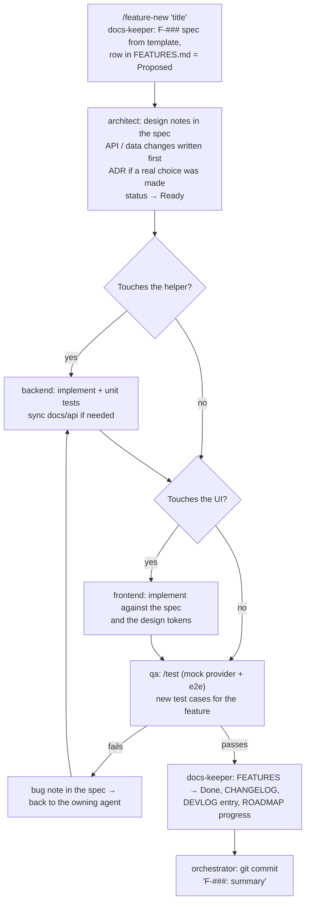

# Agentic development harness

Status: Accepted ([ADR-0007](decisions/0007-agentic-development-harness.md), [ADR-0011](decisions/0011-orchestrator-agent-and-single-harness.md)) · Last updated: 2026-11-01

HomeTV is built in Claude Code (the CLI) by one **orchestrator** that runs as the main session and hands work to five role agents. The agents live in `.claude/agents/`, and repeatable workflows are slash commands in `.claude/commands/`. `.claude/` is the only copy of the harness and is committed to git. Starting `claude` in this project uses the orchestrator by default (`"agent": "orchestrator"` in `.claude/settings.json`).
Project-wide rules are in `CLAUDE.md` at the repo root. Every agent reads it first.

## Roles

Models: orchestrator Opus 5.5; architect, backend, frontend and qa Sonnet; docs-keeper Haiku.

| Agent | Owns (may edit) | Never edits | Typical output |
| --- | --- | --- | --- |
| **orchestrator** (the main session) | Task breakdown, hand-offs, merges, commits | Code directly when an owning agent exists | A plan per feature; agents run in order or in parallel; a commit |
| **architect** | `docs/01-technical-plan.md`, `docs/decisions/`, `docs/api/API.md` (contract), `docs/database/DATA-MODEL.md` (design) | `development/` code | Feature design notes in the spec, ADRs, API/data contract changes *before* code is written |
| **backend** | `development/helper/**` except `web/`, `development/tools/mock_provider.py` | `development/helper/web/**` | Helper code, unit tests, mock-provider updates, API docs synced to the code |
| **frontend** | `development/helper/web/**`, `development/prototype/**` | `server.py` and helper modules | UI, player and navigation code, matching the design spec and tokens |
| **qa** | `development/tools/**` (tests), `docs/testing/` | Product code (reports bugs instead) | Test runs, new e2e cases, bug reports, a pass/fail verdict |
| **docs-keeper** | `docs/features/`, `docs/devlog/`, `docs/CHANGELOG.md`, `docs/ROADMAP.md`, `README.md` | Code, ADR decisions (records only what the architect decided) | Updated status, devlog entry, changelog line |

Ownership prevents two agents (or two Claude sessions) editing the same file at once. If a change crosses areas, the orchestrator runs the agents one after another, never in parallel on the same files.

## Parallel work

The orchestrator can launch several copies of one agent, so there are no extra agent files. The full rules are in `.claude/agents/orchestrator.md`. In short:

- Shared foundations are built first, one at a time.
- At most 4 engineers run at once, each in its own git worktree, on tasks that don't share files.
- Branches merge one at a time, and qa checks the merged result.
- The stream relay, player engine and credential code are never split between engineers.
- Without git and a first commit, work runs sequentially.

## The feature loop



`/feature-build F-###` runs this loop end to end. The orchestrator stops and asks the owner when:

- a decision can't be undone and could reasonably go either way (a new dependency, a storage change, removing a feature);
- the real provider or a real device is needed (agents never use real credentials);
- QA fails twice on the same issue.

## Hand-off format

Every agent ends its turn with a short block the next agent reads:

```
HANDOFF
Feature: F-021 Remember last channel
Agent: backend
Changed: development/helper/hometv/store.py, docs/api/API.md (POST /api/recent)
Tests: py -m unittest tests.test_store  → 6 passed
Open: frontend must call POST /api/recent on channel start; key name "last_live"
Next: frontend
```

## Definition of done (every feature)

- [ ] The spec's acceptance criteria are all met and ticked in the spec.
- [ ] API and data-model docs match the code (same commit).
- [ ] `/test` passes: mock provider + e2e, plus unit tests once M3 lands.
- [ ] iPhone portrait and iPad landscape screenshots checked for UI changes (Playwright device sizes).
- [ ] No credentials, real provider hosts or personal data in code, tests, logs or docs.
- [ ] FEATURES.md, CHANGELOG.md and DEVLOG.md updated by docs-keeper.
- [ ] One commit per feature: `F-###: <summary>`; ADR commits `ADR-####: <title>`.

## Slash commands

| Command | What it does |
| --- | --- |
| `/feature-new <title>` | Creates the next F-### spec from the template and registers it as Proposed |
| `/feature-build F-###` | Runs the full loop above for one feature |
| `/adr <title>` | Architect writes the next ADR from the template and adds it to the index |
| `/test` | Starts the mock provider and a test helper on port 8099, runs the e2e suite, reports results |
| `/devlog` | docs-keeper adds today's session entry from `git log` and the hand-offs |
| `/status` | Summarises ROADMAP, features in progress and the last devlog entry |

## Guardrails

- Real provider credentials are never typed into Claude. `development/helper/data/` is denied in `.claude/settings.json`.
- Tests use only the mock provider (`127.0.0.1:9001`, user `demo`). Real-provider checks are done by the owner and noted in DEVLOG.
- No new runtime dependencies in the helper (stdlib only) or the client (no bundler) without an ADR.
- The e2e suite must be green before and after any refactor.
- One Claude session per milestone. If another session (for example a design chat) is active, wait or coordinate through DEVLOG.
