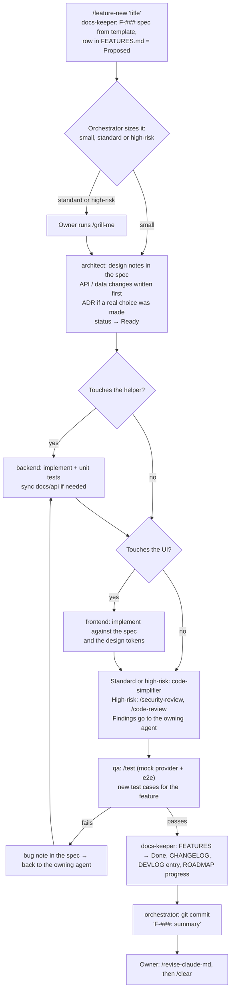

# Agentic development harness

Status: Accepted ([ADR-0007](decisions/0007-agentic-development-harness.md), [ADR-0011](decisions/0011-orchestrator-agent-and-single-harness.md), [ADR-0013](decisions/0013-harness-tooling-and-precedence.md)) · Last updated: 2026-11-01

HomeTV is built in Claude Code (the CLI) by one **orchestrator** that runs as the main session and hands work to five role agents. The agents live in `.claude/agents/`, and repeatable workflows are slash commands in `.claude/commands/`. `.claude/` is the only copy of the harness and is committed to git. Starting `claude` in this project uses the orchestrator by default (`"agent": "orchestrator"` in `.claude/settings.json`).
Project-wide rules are in `CLAUDE.md` at the repo root. Every agent reads it first.

## Roles

Models: orchestrator Opus 5.5; architect, backend, frontend and qa Sonnet; docs-keeper Haiku. The `code-simplifier` plugin agent defaults to Opus, so the orchestrator runs it on Sonnet. It works for the orchestrator, on the changed files it is given.

| Agent | Owns (may edit) | Never edits | Typical output |
| --- | --- | --- | --- |
| **orchestrator** (the main session) | Task breakdown, hand-offs, merges, commits | Code directly when an owning agent exists | A plan per feature; agents run in order or in parallel; a commit |
| **architect** | `docs/01-technical-plan.md`, `docs/decisions/`, `docs/api/API.md` (contract), `docs/database/DATA-MODEL.md` (design) | Code in `helper/`, `tools/` or `apps/` | Feature design notes in the spec, ADRs, API/data contract changes *before* code is written |
| **backend** | `helper/**` except `web/`, `tools/mock_provider.py` | `helper/web/**` | Helper code, unit tests, mock-provider updates, API docs synced to the code |
| **frontend** | `helper/web/**`, `docs/design/prototype/**` | `server.py` and helper modules | UI, player and navigation code, matching the design spec and tokens |
| **qa** | `tools/**` (tests), `docs/testing/` | Product code (reports bugs instead) | Test runs, new e2e cases, bug reports, a pass/fail verdict |
| **docs-keeper** | `docs/features/`, `docs/devlog/`, `docs/CHANGELOG.md`, `docs/ROADMAP.md`, `README.md` | Code, ADR decisions (records only what the architect decided) | Updated status, devlog entry, changelog line |

Ownership prevents two agents (or two Claude sessions) editing the same file at once. If a change crosses areas, the orchestrator runs the agents one after another, never in parallel on the same files.

## Parallel work

The orchestrator can launch several copies of one agent, so there are no extra agent files. The full rules are in `.claude/agents/orchestrator.md`. In short:

- Shared foundations are built first, one at a time.
- At most 4 engineers run at once, each in its own git worktree, on tasks that don't share files.
- Branches merge one at a time, and qa checks the merged result.
- The stream relay, player engine and credential code are never split between engineers.
- Without git and a first commit, work runs sequentially.

## The feature loop



`/feature-build F-###` runs this loop end to end. The orchestrator stops and asks the owner when:

- a decision can't be undone and could reasonably go either way (a new dependency, a storage change, removing a feature);
- the real provider or a real device is needed (agents never use real credentials);
- QA fails twice on the same issue.

## Hand-off format

Every agent ends its turn with a short block the next agent reads:

```
HANDOFF
Feature: F-021 Remember last channel
Agent: backend
Changed: helper/hometv/store.py, docs/api/API.md (POST /api/recent)
Tests: py -m unittest tests.test_store  → 6 passed
Open: frontend must call POST /api/recent on channel start; key name "last_live"
Next: frontend
```

## Definition of done (every feature)

- [ ] The spec's acceptance criteria are all met and ticked in the spec.
- [ ] API and data-model docs match the code (same commit).
- [ ] `/test` passes: mock provider + e2e, plus unit tests once M3 lands.
- [ ] iPhone portrait and iPad landscape screenshots checked for UI changes (Playwright device sizes).
- [ ] High-risk work: `/security-review` and `/code-review` done, with findings fixed before qa.
- [ ] No credentials, real provider hosts or personal data in code, tests, logs, docs or `.claude/agent-memory/`.
- [ ] FEATURES.md, CHANGELOG.md and DEVLOG.md updated by docs-keeper.
- [ ] One commit per feature: `F-###: <summary>`; ADR commits `ADR-####: <title>`.

## Slash commands

| Command | What it does |
| --- | --- |
| `/grill-me` | The owner is interviewed on a plan until every decision is settled |
| `/feature-new <title>` | Creates the next F-### spec from the template and registers it as Proposed |
| `/feature-build F-###` | Runs the full loop above for one feature |
| `/adr <title>` | Architect writes the next ADR from the template and adds it to the index |
| `/test` | Starts the mock provider and a test helper on port 8099, runs the e2e suite, reports results |
| `/devlog` | docs-keeper adds today's session entry from `git log` and the hand-offs |
| `/status` | Summarises ROADMAP, features in progress and the last devlog entry |

## Token use

The working rules are in `CLAUDE.md` (all agents) and `.claude/agents/orchestrator.md` (briefs and team size). The main costs are agent start-up reading, large files, test output and screenshots.

- **Reading:** each agent reads its own "Read first" list and the spec, and searches before opening large files.
- **Blocked files:** `helper/web/lib/**` and `docs/design/prototype/demo-video.js` are vendored or generated, so `.claude/settings.json` denies reading them. Remove the rule for a task that truly needs them, such as an ADR-approved library update.
- **Models:** routine work stays on Sonnet and Haiku. Opus is for the orchestrator.
- **Sessions:** one feature per session, then `/clear`. Use `/compact` if a long feature fills the context. Use `/context` to see what is taking space and `/cost` or `/usage` to check spending.

## Memory and skills

**Memory** has five layers, and the table in `CLAUDE.md` says what goes where:

- **Repo records:** feature specs, HANDOFF blocks, ADRs and DEVLOG carry the project's history. A new session restarts from the spec's work log.
- **Agent memory:** backend, frontend and qa have `memory: project`, so each keeps lessons in `.claude/agent-memory/<agent>/`. The first 200 lines or 25 KB of its `MEMORY.md` load at start-up. These files are committed, so they get the same secret checks as code.
- **Auto memory:** Claude Code's built-in notes for the main session, kept on this machine only.
- **CLAUDE.md upkeep:** the `claude-md-management` plugin adds `/revise-claude-md` to capture lessons at the end of a session, and an audit skill ("audit my CLAUDE.md"). Run the audit at each milestone.

- **claude-mem:** searchable history of main sessions, stored on this machine. Subagent capture is off, so it doesn't duplicate agent memory. Its settings are in `~/.claude-mem/settings.json`, not in git.

**Skills** follow the table in `CLAUDE.md`, and this harness beats any skill text. Design skills run only for a new or reshaped screen, and `docs/design/` always wins.

| Agent | Skills and tools |
| --- | --- |
| orchestrator | `/security-review`, `/code-review`, `graphify`, the `code-simplifier` agent |
| owner | `/grill-me`, `/revise-claude-md` |
| backend | Superpowers TDD, debugging and verification; `graphify`; context-mode (trial) |
| frontend | Superpowers debugging and verification; `graphify`; context-mode (trial); `frontend-design:frontend-design`, `design:ux-copy`, `design:design-system` |
| qa | Superpowers debugging and verification; `engineering:testing-strategy`; context-mode; `design:accessibility-review`, `design:design-critique` |

The context-mode trial runs for two tasks: the iPhone guide fix and the `/api/status` stall investigation. Compare `/ctx-stats` with the added start-up cost, then keep it only if the saving is clearly larger. Architect stays out because it has no shell on purpose.

Eight Superpowers skills and 28 claude-mem skills are denied in `.claude/settings.json` because they would compete with this loop or don't apply here. A deny rule stops a skill running but leaves it in the start-up list. `skillOverrides` hides account and bundled skills from Claude while the owner can still type them; it doesn't work on plugin skills. The `design:` and `engineering:` skills come from the owner's claude.ai account. claude-mem, graphify and Bun are per-machine tools, so a new machine needs them installed. Adding another plugin needs the owner's approval and an ADR.

### Size of change

| Size | Meaning | Steps added to the basic loop |
| --- | --- | --- |
| Small | One owning agent; no API, data, dependency or credential change | None. qa runs the affected cases |
| Standard | Most features | `/grill-me`, code-simplifier |
| High-risk | Relay, player, provider adapters, stream tokens, storage, credentials | Also `/security-review` and `/code-review`. code-simplifier skips this code |

### Enforced controls

- Reads and edits of `helper/data/` are denied, and `.claude/hooks/block-secrets.sh` stops shell and sandbox commands that name it. The hook matches command text, so it's a safety net, not a full sandbox.
- The competing Superpowers and claude-mem skills are denied. `git push` and `git add` are allowed, so pushing and staging named files only are rules for agents to follow, not enforced blocks.
- claude-mem redacts common secrets, MAC addresses and stream URLs, and cloud sync is unset.
- `tools/` and credential rules still depend on agents following them, so qa and `/security-review` check the results.

## Guardrails

- Real provider credentials are never typed into Claude. `helper/data/` is denied in `.claude/settings.json`.
- Tests use only the mock provider (`127.0.0.1:9001`, user `demo`). Real-provider checks are done by the owner and noted in DEVLOG.
- No new runtime dependencies in the helper (stdlib only) or the client (no bundler) without an ADR.
- The e2e suite must be green before and after any refactor.
- One active Claude session at a time, and one feature per session. If another session (for example a design chat) is active, wait or coordinate through DEVLOG.

## Setup and recovery

**New machine:** install Node.js 22.5 or later, Python 3.13 and `uv`, then run `npm install -g bun` and `uv tool install --python 3.13 graphifyy`. Copy the claude-mem settings described in ADR-0013 to `~/.claude-mem/settings.json` before first use, and run `npx claude-mem telemetry disable`. Run `git remote set-head origin main`, because `/security-review` needs `origin/HEAD`. Restart the editor so the PATH updates. Confirm with `claude plugin list`.

**A plugin misbehaves:** run `claude plugin disable <name> --scope project`, restart the session and carry on. The harness works without any plugin, except for the skills it names.

**claude-mem stops capturing:** look for `~/.claude-mem/CAPTURE_BROKEN`, which holds the reason. The usual cause is Bun missing from the PATH. Specs and ADRs are unaffected.

**Guard hook blocks a safe command:** reword the command so it doesn't name `helper/data`. Don't remove the hook.

**After a plugin update:** check that `.claude/settings.json` still denies every workflow skill the update ships, then run the session test in this section.

**Session test:** start a session, ask for a new feature plan, and confirm that the orchestrator uses the spec rather than a Superpowers plan. Run `/context` to check start-up size.
