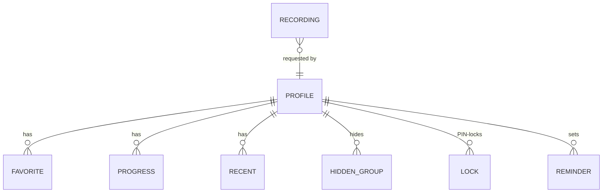

# HomeTV data model

Schema version **1** · Owner: architect (design), backend (implementation) · Last updated: 2026-11-01

HomeTV keeps no copy of the provider's catalogue. Channels, movies and series are always read live from the provider (cached briefly in memory).
What it does store is small household data, in two JSON files on the helper ([ADR-0004](../decisions/0004-json-files-for-household-data.md)), plus caches.
A move to SQLite is designed below for when profiles and recordings arrive (Phase 4 / M6). It needs an ADR before it happens.

## Where data lives

| Store | Location | Contains | Persisted | Secret |
| --- | --- | --- | --- | --- |
| `config.json` | `helper/data/` | Provider login, user agent, clock offset | yes | **yes** |
| `userdata.json` | `helper/data/` | Favorites, hidden groups, resume points, recent channels | yes | no (household) |
| `epg.xml` | `helper/data/` | Last downloaded XMLTV guide (refreshed every 12 h) | yes (cache) | no |
| Guide index | helper memory | Programmes −24 h…+36 h per guide channel ID | no | no |
| List cache | helper memory | Raw `/api/x` responses, 30 min | no | no |
| Account cache | helper memory | `user_info` + `server_info`, 5 min | no | no |
| Token map | helper memory | Token → upstream URL (≤ 30,000, oldest evicted) | no | contains credentials in URLs |
| Device prefs | browser `localStorage` | View, last groups, stream format, open-on choice | per device | no |

`helper/data/` is git-ignored and denied to Claude agents.

## config.json

```json
{
  "server": "http://provider.example:8080",
  "username": "demo",
  "password": "secret",
  "user_agent": "",
  "tz_offset": 3600
}
```

| Field | Type | Rules |
| --- | --- | --- |
| `server` | string | Normalised: scheme + host[:port] + base path, no trailing slash |
| `username`, `password` | string | Required; never logged or returned by any endpoint |
| `user_agent` | string | Empty = default `VLC/3.0.20 LibVLC/3.0.20` |
| `tz_offset` | int (s) | Provider clock − UTC, snapped to 15 min; refreshed with the account status |

**Stalker portal variant (F-036, not built yet).** `type` absent means `"xtream"` (all existing files):

```json
{
  "type": "stalker",
  "portal": "http://portal.example:8080/c/",
  "api": "http://portal.example:8080/server/load.php",
  "mac": "00:1A:79:12:34:56",
  "serial": "", "device_id": "", "device_id2": "", "signature": "",
  "timezone": "America/Los_Angeles",
  "user_agent": ""
}
```

| Field | Rules |
| --- | --- |
| `type` | `"xtream"` or `"stalker"` |
| `portal` | As entered by the owner |
| `api` | Endpoint discovered at setup (`/server/load.php`, `/stalker_portal/server/load.php` or `/portal.php`) |
| `mac` | Secret. Upper case, colon-separated; never logged or returned (only a 2-byte hint) |
| `serial`, `device_id`, `device_id2`, `signature` | Optional overrides; empty = derived from the MAC at runtime |
| `timezone` | IANA name sent in the portal cookie; empty = the helper's local zone |

The portal session token is kept in memory only.

## userdata.json

```json
{
  "schema_version": 1,
  "favorites": {
    "live":   [{ "id": "104", "name": "Channel name", "icon": "http://..." }],
    "movie":  [{ "id": "501", "name": "Film (2021)", "icon": "http://...", "ext": "mp4" }],
    "series": [{ "id": "900", "name": "Show", "icon": "http://..." }]
  },
  "hidden": { "live": ["3"], "movie": [], "series": ["20"] },
  "progress": {
    "movie:501":    { "name": "Film (2021)", "icon": "...", "ext": "mp4", "pos": 2540.2, "dur": 7200, "t": 1793547115 },
    "episode:7001": { "name": "Show · S1 E1", "icon": "...", "ext": "mkv", "series_id": "900", "series_name": "Show",
                      "pos": 600, "dur": 2700, "t": 1793547200 }
  },
  "recent": ["104", "101"]
}
```

| Path | Type | Rules |
| --- | --- | --- |
| `schema_version` | int | **Not written yet**: files without it are treated as 1. F-032 starts writing it |
| `favorites.{live,movie,series}[]` | object | `id` (string, required), `name`, `icon`, `ext`, `cat`. Unique by `id`; newest last |
| `hidden.{live,movie,series}[]` | string | Provider category IDs |
| `progress` key | string | `movie:{stream_id}` or `episode:{episode_id}` |
| `progress.*.pos`, `dur` | number (s) | Removed when `pos < 15` or `pos/dur > 0.95`; max 300 entries (oldest `t` dropped) |
| `progress.*.t` | int | Unix seconds of the last save |
| `recent[]` | string | Live stream IDs, newest first, max 30 |

**Write rules:** every write takes the store lock, changes memory, then writes the whole file atomically (`.tmp` + `os.replace`). Last write wins per endpoint call. That's fine for one household; profiles will need per-profile keys.

## Guide index (memory)

`epg.data: dict[str, list[tuple[start:int, stop:int, title:str, desc:str]]]`, keyed by XMLTV `channel` attribute (= the provider's `epg_channel_id`), sorted by start. Built by a streaming parse (`iterparse` + `clear()`), keeping only programmes overlapping now −24 h … +36 h (`HOMETV_EPG_PAST_HOURS`, `HOMETV_EPG_FUTURE_HOURS`).

## Versioning and migrations

1. Any change to a persisted shape bumps `schema_version` here and in code.
2. backend adds a `migrate_vN_to_vN+1(data)` function in the store module, run on load. The original file is backed up as `userdata.v{N}.bak.json` first.
3. Additive optional fields don't need a bump but must be documented in the tables above.
4. Each change gets a row in the change log below.

## Planned: SQLite for profiles and recordings (M6, needs an ADR)

Profiles (F-024), a parental PIN (F-025) and recordings (Phase 4 DVR) make per-person data and concurrent writes common. The proposal is Python's built-in `sqlite3` (still stdlib only), file `helper/data/hometv.db`, WAL mode.



```sql
CREATE TABLE profile (
  id INTEGER PRIMARY KEY, name TEXT NOT NULL, avatar TEXT, is_kid INTEGER NOT NULL DEFAULT 0,
  pin_hash TEXT, created_at INTEGER NOT NULL
);
CREATE TABLE favorite (
  profile_id INTEGER NOT NULL REFERENCES profile(id) ON DELETE CASCADE,
  kind TEXT NOT NULL CHECK (kind IN ('live','movie','series')),
  item_id TEXT NOT NULL, name TEXT, icon TEXT, ext TEXT, category_id TEXT, added_at INTEGER NOT NULL,
  PRIMARY KEY (profile_id, kind, item_id)
);
CREATE TABLE progress (
  profile_id INTEGER NOT NULL REFERENCES profile(id) ON DELETE CASCADE,
  kind TEXT NOT NULL CHECK (kind IN ('movie','episode')),
  item_id TEXT NOT NULL, pos REAL NOT NULL, dur REAL NOT NULL, name TEXT, icon TEXT, ext TEXT,
  series_id TEXT, series_name TEXT, updated_at INTEGER NOT NULL,
  PRIMARY KEY (profile_id, kind, item_id)
);
CREATE INDEX progress_recent ON progress(profile_id, updated_at DESC);
CREATE TABLE recent (
  profile_id INTEGER NOT NULL REFERENCES profile(id) ON DELETE CASCADE,
  stream_id TEXT NOT NULL, watched_at INTEGER NOT NULL, PRIMARY KEY (profile_id, stream_id)
);
CREATE TABLE hidden_group (
  profile_id INTEGER NOT NULL REFERENCES profile(id) ON DELETE CASCADE,
  kind TEXT NOT NULL, category_id TEXT NOT NULL, PRIMARY KEY (profile_id, kind, category_id)
);
CREATE TABLE lock (
  profile_id INTEGER NOT NULL REFERENCES profile(id) ON DELETE CASCADE,
  kind TEXT NOT NULL CHECK (kind IN ('category','channel')), target_id TEXT NOT NULL,
  PRIMARY KEY (profile_id, kind, target_id)
);
CREATE TABLE reminder (
  id INTEGER PRIMARY KEY, profile_id INTEGER NOT NULL REFERENCES profile(id) ON DELETE CASCADE,
  stream_id TEXT NOT NULL, start INTEGER NOT NULL, title TEXT NOT NULL
);
CREATE TABLE recording (
  id INTEGER PRIMARY KEY, profile_id INTEGER REFERENCES profile(id) ON DELETE SET NULL,
  stream_id TEXT NOT NULL, start INTEGER NOT NULL, stop INTEGER NOT NULL, title TEXT,
  status TEXT NOT NULL CHECK (status IN ('scheduled','recording','done','failed')),
  file_path TEXT, bytes INTEGER
);
CREATE TABLE meta (key TEXT PRIMARY KEY, value TEXT NOT NULL);  -- schema_version lives here
```

Migration from JSON: create one profile "Family", import `userdata.json` into it, keep the JSON as a backup, and keep the existing API responses identical for the default profile (API v1 compatible; profile-aware endpoints are additive).

## Change log

| Date | Schema | Change | Feature |
| --- | --- | --- | --- |
| 2026-11-01 | 1 | Initial: config.json, userdata.json | F-001–F-018 |
| 2026-11-01 | 1 (planned) | `config.json` gains `type` and the Stalker fields; userdata unchanged | F-036 |
